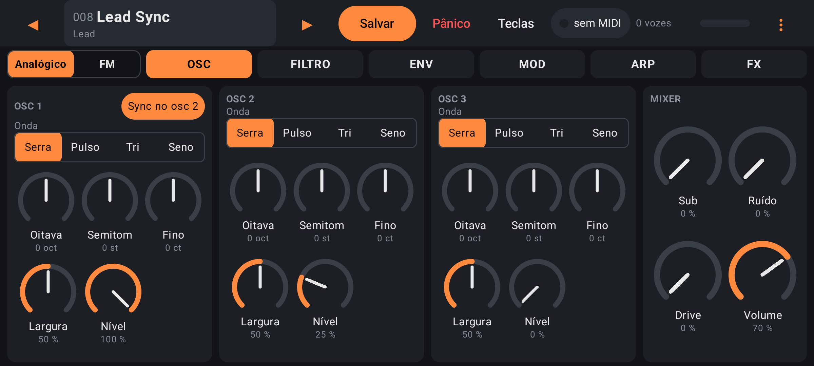
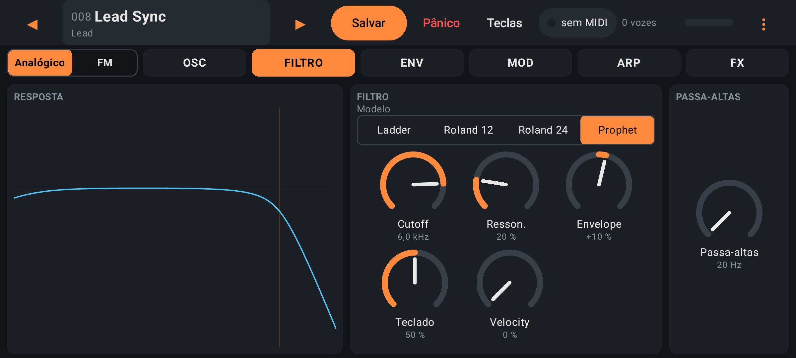
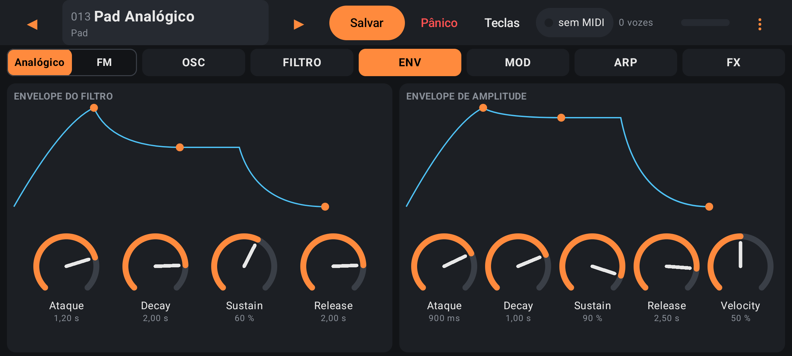
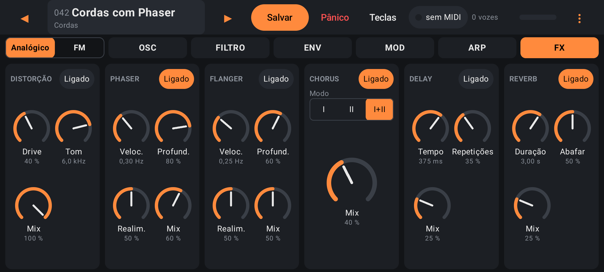
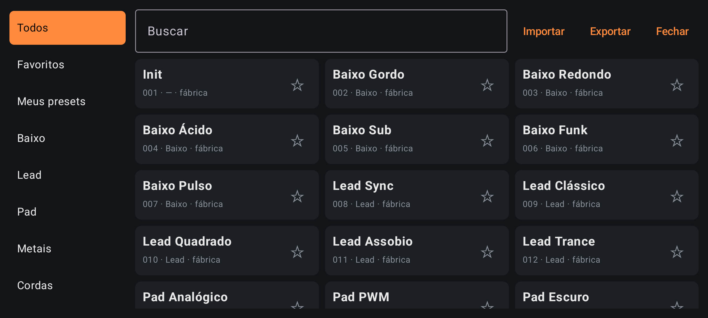
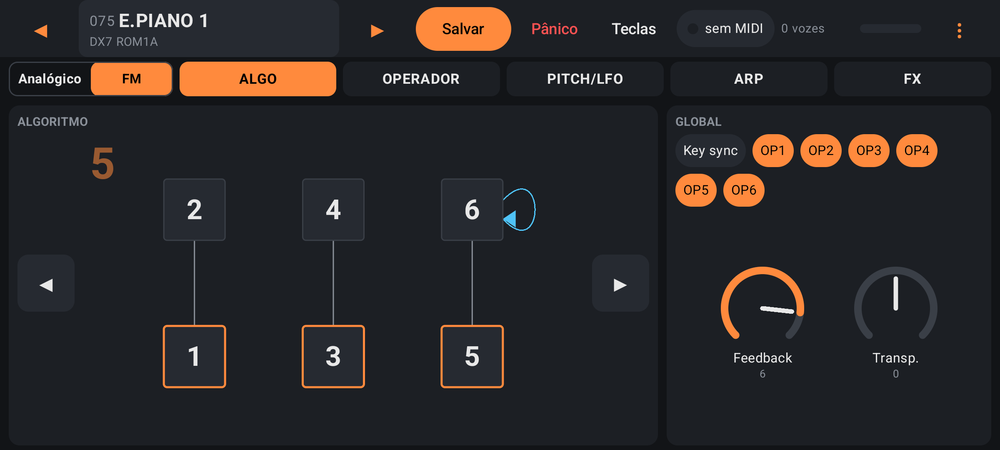
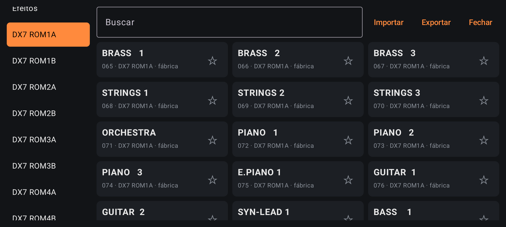
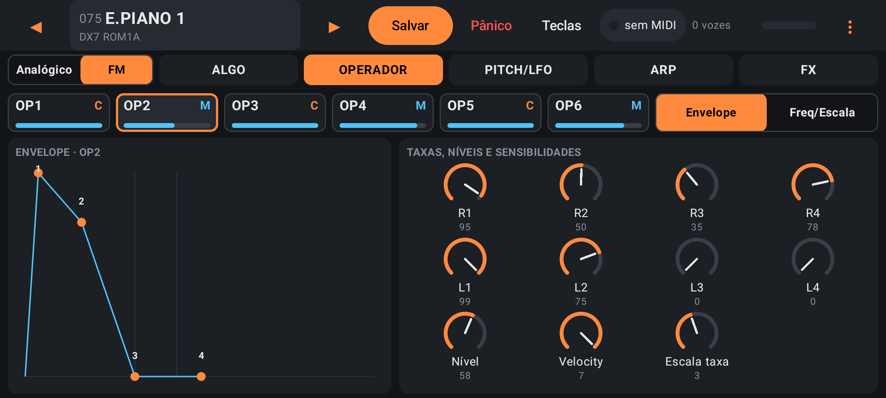
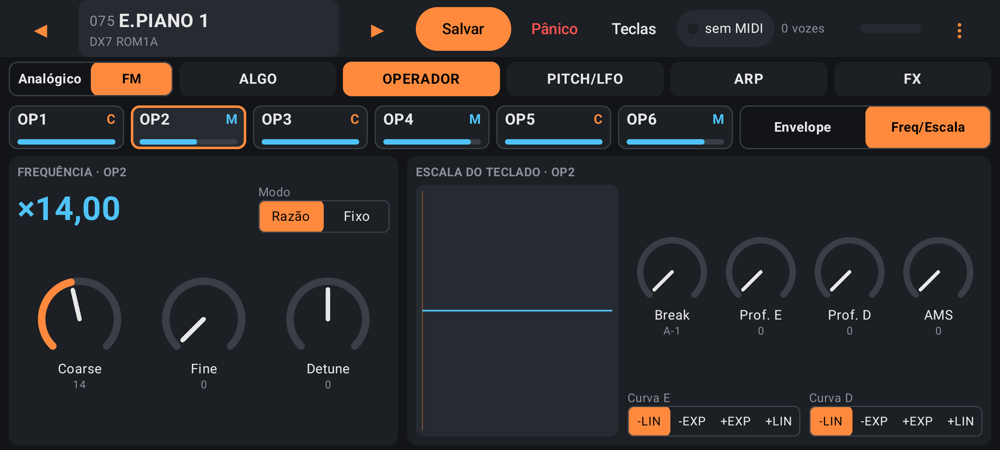
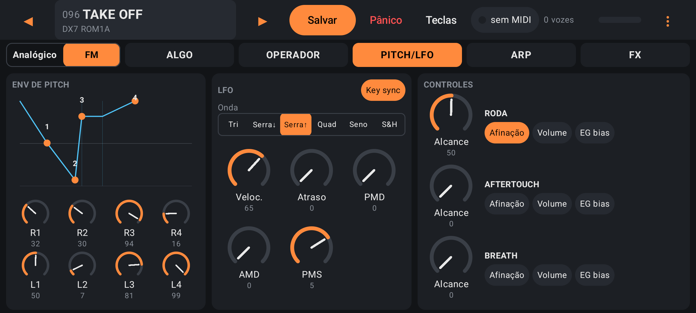

# Volt

Volt é um sintetizador analógico virtual polifônico para Android, tocado por teclado MIDI USB com baixa latência. Além do motor analógico, tem um motor FM de 6 operadores compatível com o Yamaha DX7, que lê cartuchos `.syx`.

<p align="center">
  
</p>

## Telas

Tema escuro, em paisagem, com controles grandes para o dedo. Capturas do emulador Android.

### Motor analógico

Três osciladores, quatro modelos de filtro, dois envelopes, dois LFOs, poly-mod e seis efeitos.

<table>
  <tr>
    <td width="50%"><br><sub><b>FILTRO</b>: modelo, cutoff, ressonância e a curva de resposta desenhada ao vivo.</sub></td>
    <td width="50%"><br><sub><b>ENV</b>: envelopes de filtro e de amplitude, com os pontos do desenho arrastáveis.</sub></td>
  </tr>
  <tr>
    <td width="50%"><br><sub><b>FX</b>: distorção, phaser, flanger, chorus, delay e reverb em série.</sub></td>
    <td width="50%"><br><sub><b>Presets</b>: 64 de fábrica, os seus, favoritos, busca, importar e exportar.</sub></td>
  </tr>
</table>

### Motor FM compatível com o DX7

Seis operadores, 32 algoritmos, envelopes de 4 taxas e 4 níveis, escala de teclado, LFO e envelope de pitch, como no DX7. Os 256 sons dos cartuchos de fábrica estão no navegador, e qualquer cartucho `.syx` de 32 vozes pode ser importado ou exportado. Os efeitos, o arpejador e o MIDI são os mesmos do motor analógico.

<table>
  <tr>
    <td width="50%"><br><sub><b>ALGO</b>: o algoritmo desenhado (portadoras com contorno laranja, laço de feedback em azul), feedback, transposição e liga/desliga de cada operador.</sub></td>
    <td width="50%"><br><sub><b>Cartuchos</b>: ROM1A a ROM4B, 32 vozes cada, com os nomes originais.</sub></td>
  </tr>
  <tr>
    <td width="50%"><br><sub><b>OPERADOR · Envelope</b>: desenho das 4 taxas e 4 níveis com pontos arrastáveis.</sub></td>
    <td width="50%"><br><sub><b>OPERADOR · Freq/Escala</b>: razão ou frequência fixa com a leitura da frequência, e escala de teclado.</sub></td>
  </tr>
  <tr>
    <td colspan="2"><br><sub><b>PITCH/LFO</b>: envelope de pitch, LFO e o roteamento da roda, do aftertouch e do breath.</sub></td>
  </tr>
</table>

## Estado

Versão 1.0.0. Todos os cinco planos estão implementados: motor C++ de 16 vozes (3 osciladores, filtro Ladder / Roland 12 dB / Roland 24 dB / Prophet, 2 envelopes, 2 LFOs, poly-mod, modos poly/mono/legato/unison), saída de áudio Oboe de baixa latência, entrada MIDI USB com mapa de controladores de fábrica, a tela de toque (abas OSC · FILTRO · ENV · MOD · ARP · FX, knobs, curva do filtro e envelopes ao vivo), presets (64 de fábrica nivelados por medição, os seus, navegador, favoritos, importar/exportar, sessão restaurada), MIDI Learn, seis efeitos (distorção, phaser, flanger, chorus, delay, reverb), arpejador, teclado deslizante na tela e polifonia que cai sozinha quando o celular não acompanha (com teto manual de 8, 12 ou 16 vozes em ⋮). Há ainda ícone, "Sobre o Volt" e exportação de log.

O que foi e o que não foi testado: o motor e os 64 presets são medidos por testes no PC (soam, não geram NaN, liberam as vozes, nível dentro de uma janela); a tela foi vista no emulador. **No aparelho, só foram ouvidos os 10 primeiros presets e o caminho CK61 → som (plano 1).** Os outros 54 presets, os efeitos, o arpejador, o teclado na tela, o MIDI Learn e a polifonia sob carga ainda não foram avaliados no celular: veja `docs/DEVICE-TEST.md`, `docs/PRESET-REVIEW.md` e `docs/NOTES.md`.

## Ouvir os presets no PC

```powershell
.\tools\render-presets.ps1           # gera build\render\*.wav e abre build\render\index.html, com um player por preset
.\tools\render-presets.ps1 -Stress   # custo de CPU de cada preset com 16 notas
```

Anote o veredito de cada um em `docs/PRESET-REVIEW.md`.

## Versão de release

```powershell
.\tools\make-keystore.ps1            # uma vez: o keytool pede as senhas
# crie keystore.properties na raiz (modelo no topo do script; o arquivo não vai para o git)
.\gradlew.bat :app:assembleRelease    # app\build\outputs\apk\release\app-release.apk
```

**Faça backup do `.jks` e das senhas**: sem eles nenhuma versão futura consegue atualizar o app instalado. Sem `keystore.properties` o Gradle gera `app-release-unsigned.apk`, que o Android não instala. O debug usa outro id (`com.criapix.volt.debug`, "Volt dev") e convive com o release.

## Compilar (Windows, PowerShell)

```powershell
git submodule update --init          # sst-filters, sst-basic-blocks, sst-effects, fmt, simde
. .\tools\env.ps1                    # MSVC do VS 2022 Build Tools, JAVA_HOME, ANDROID_HOME
.\tools\test-engine.ps1              # compila e roda os testes do motor no PC
.\gradlew.bat :app:testDebugUnitTest :app:assembleDebug
```

O APK de debug sai em `app\build\outputs\apk\debug\app-debug.apk`.

## Teclado MIDI

Conecte o teclado por cabo USB (celular como host) antes ou depois de abrir o app; a tela mostra "MIDI: N conectado(s)" e a última mensagem recebida. Mapa de fábrica: modulação (CC 1), volume (CC 7), sustain (CC 64), ressonância (CC 71), cutoff (CC 74), release (CC 72), ataque (CC 73) e decay (CC 75) do envelope de amplitude, reverb (CC 91), chorus (CC 93) e phaser (CC 95; mexer acima de zero liga o efeito), pitch bend, e CC 120/123 como pânico.

**MIDI Learn.** Toque no botão MIDI da barra superior: o app entra no modo aprender (botão laranja "APRENDER"). Toque num controle da tela (knob, seletor, botão, ◀ ▶ ou Pânico) e depois mexa num controle do teclado; a associação vale na hora e fica salva. Notas só podem ser associadas a ações (preset anterior, próximo, pânico). Uma associação aprendida vale mais que o mapa de fábrica. A **captura suave** evita saltos: depois de trocar de preset, o controle só assume o parâmetro quando passa pelo valor atual (a tela diz até onde levá-lo); dá para desligá-la. O **Program Change** carrega o preset na posição correspondente da biblioteca. O mapa (lista de associações, canal Omni ou 1–16, captura suave, última mensagem) fica em ⋮ → Controle MIDI, ou em "Mapa…" no modo aprender.

## Presets

Os presets do usuário ficam dentro do app (pasta privada); use **Exportar** no navegador de presets para fazer backup e **Importar** para trazê-los de volta. Um preset é um arquivo JSON com `name`, `category` e `params`, que mapeia o nome permanente de cada parâmetro ao seu valor real (Hz, segundos, semitons); o que faltar assume o padrão do motor. Os presets de fábrica são somente leitura: para alterar um, salve como novo.

## Licença

GPL-3.0-or-later (arquivo `LICENSE`). Bibliotecas de terceiros, em `third_party/`:
- Oboe: Apache 2.0
- sst-filters: GPL-3
- sst-basic-blocks: GPL-3
- sst-effects: GPL-3
- fmt: MIT
- simde: MIT

Design: [docs/plans/2026-11-11-volt-design.md](docs/plans/2026-11-11-volt-design.md)
